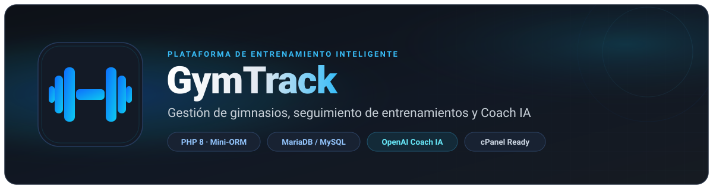
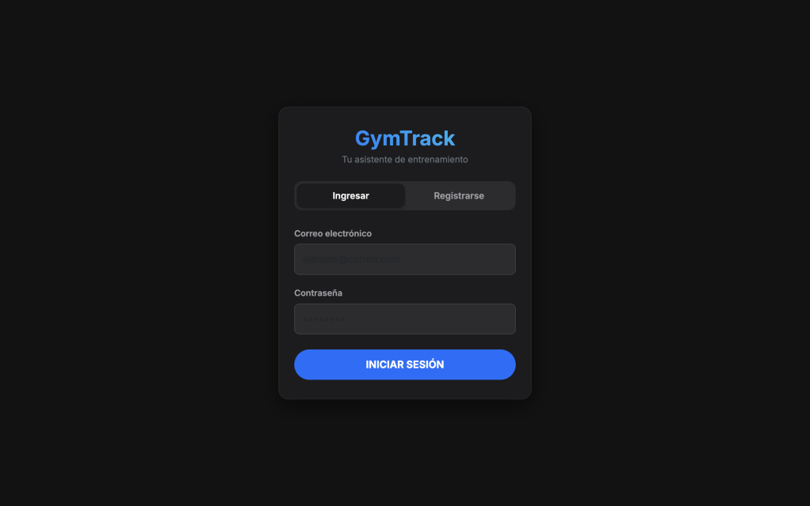
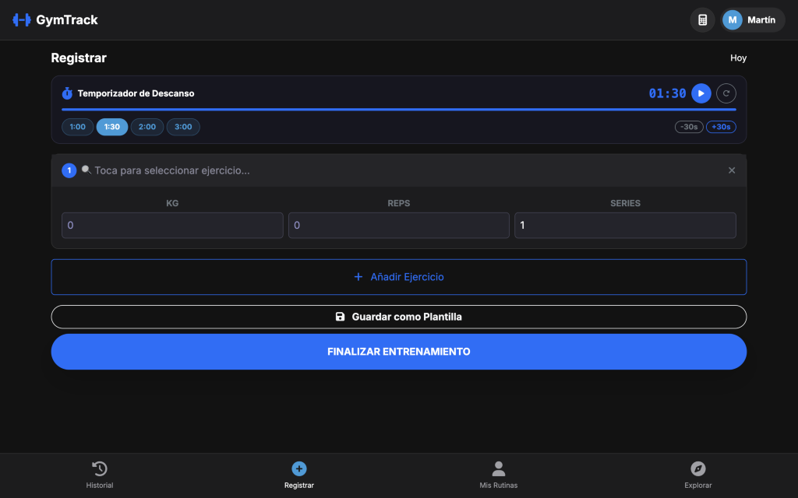
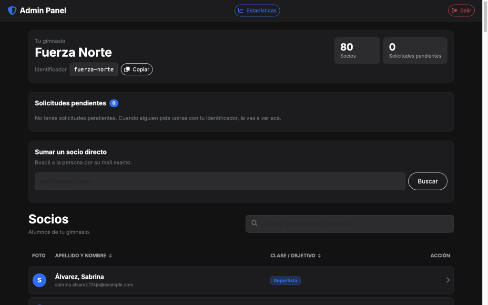
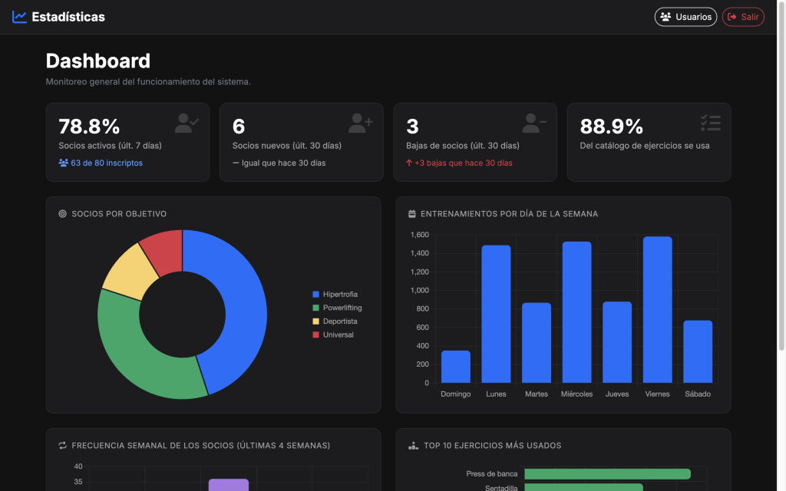
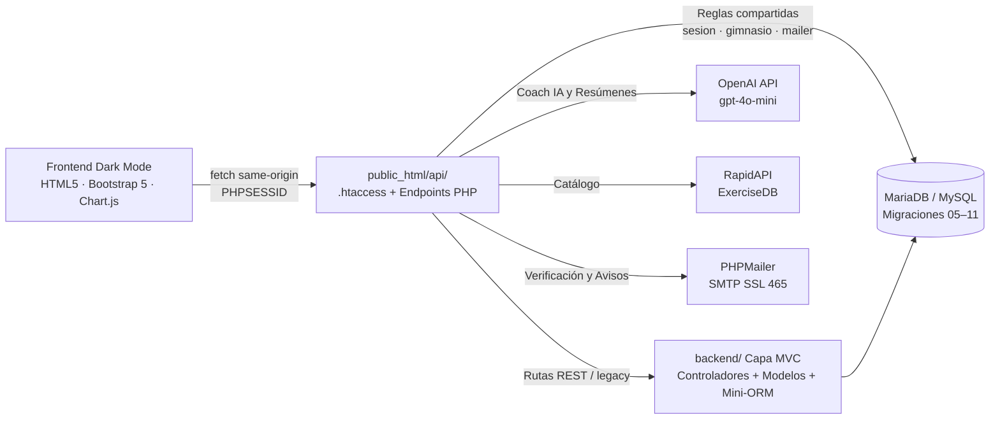

<div align="center">



<br />

[](https://gymtrack.com.ar)


<p>
  <strong>Aplicación web integral para gimnasios y socios.</strong><br />
  Rutinas personalizadas, registro de cargas, asistencia automática, panel de métricas multi-sede y Coach Virtual con IA agéntica — lista para correr en hosting compartido cPanel sin <code>vendor/</code>.
</p>

<p>
  <a href="#caracteristicas-principales">Características</a> ·
  <a href="#capturas-de-pantalla">Capturas</a> ·
  <a href="#arquitectura">Arquitectura</a> ·
  <a href="#estructura">Estructura</a> ·
  <a href="#documentacion">Documentación</a> ·
  <a href="#puesta-en-marcha-local">Instalación</a> ·
  <a href="#seguridad">Seguridad</a> ·
  <a href="#equipo">Equipo</a>
</p>

</div>

---

## Características principales

### Experiencia del Socio
- **Entrenamientos y progreso:** registro de series, repeticiones y pesos por ejercicio, historial detallado y cálculo automático de asistencia diaria al guardar una sesión.
- **Rutinas y catálogo:** rutinas propias, favoritas y catálogo de ejercicios con videos demostración y sincronización externa.
- **Coach Virtual IA (`gpt-4o-mini`):** asistente conversacional con *Function Calling* capaz de crear y guardar rutinas directamente en la cuenta del socio mediante transacciones relacionales.
- **Gimnasios y verificación:** confirmación de cuenta por correo electrónico al registrarse, búsqueda de gimnasios por identificador exacto, envío de solicitudes de ingreso y avisos automáticos por mail ante altas o bajas.

### Panel del Administrador
- **Aislamiento estricto por sede (`1 admin = 1 gimnasio`):** cada dueño crea y administra únicamente su propio gimnasio y ve solo a sus socios.
- **Gestión de ingresos:** aprobación o rechazo de solicitudes pendientes (con *cooldown* de 7 días tras rechazo) y vinculación o desvinculación directa de socios.
- **Dashboard de métricas (`estadisticas.html`):** socios activos, comparación de altas y bajas de los últimos 30 días frente al período anterior, concurrencia por día de la semana y distribución por turno.

### Automatizaciones del Servidor
- **Recordatorios de inactividad (`cron_inactividad.php`):** detecta socios sin actividad reciente y envía correos HTML personalizados evitando reenvíos repetidos.
- **Resúmenes mensuales con IA (`cron_resumen_mensual.php`):** agrega días entrenados, volumen total y marcas máximas del mes cerrado junto a un análisis motivacional generado por OpenAI.
- **Catálogo ExerciseDB (`cron_sync_exercisedb.php`):** sincronización incremental por *offset* sin desperdiciar cuota de API, con auditoría centralizada en `Automation_Log`.

---

## Capturas de pantalla

| Acceso y verificación de cuenta | Registro de entrenamientos (`index.html`) |
| :---: | :---: |
|  |  |

| Panel de administración (`admin.html`) | Dashboard de estadísticas (`estadisticas.html`) |
| :---: | :---: |
|  |  |

---

## Arquitectura

GymTrack implementa una arquitectura dual pensada para combinar el patrón **MVC + Mini-ORM estilo Eloquent** con despliegue liviano en hosting compartido (cPanel, sin carpeta `vendor/` ni Composer requerido en producción):



- `api/.htaccess` redirige hacia `backend/bootstrap/app.php` toda petición que no coincida con un archivo PHP físico; las reglas compartidas (`sesion.php`, `gimnasio_lib.php`, `movimientos.php`, `mailer_lib.php`) mantienen una única fuente de verdad entre ambas capas.

---

## Estructura

La estructura del repositorio replica directamente el árbol del hosting (`public_html/` y `backend/` quedan **una al lado de la otra**):

```text
GymTrack/
├── public_html/                  # Raíz web pública
│   ├── index.html                # App del socio (rutinas, entrenamientos, perfil, coach IA)
│   ├── login.html                # Ingreso, registro y confirmación de correo
│   ├── admin.html                # Panel del administrador (gimnasio, socios, solicitudes)
│   ├── estadisticas.html         # Dashboard de métricas del gimnasio
│   ├── api/                      # Endpoints PHP directos, PHPMailer y plantillas *.example.php
│   ├── demo/                     # Simulador de actividad para demostración (ver docs/DEMO.md)
│   └── img/, videos/             # Recursos visuales y videos de ejercicios
├── backend/                      # Capa MVC (fuera de la raíz pública web)
│   ├── app/Http/Controllers/     # Auth, Admin, Coach, Ejercicio, Gimnasio, Historial, Perfil, Rutina, Solicitud
│   ├── app/Models/               # Modelos Eloquent propios
│   ├── bootstrap/                # Router y Mini-ORM standalone (EloquentAutoload.php)
│   └── routes/api.php            # Definición declarativa de rutas
├── migrations/                   # Migraciones SQL numeradas (05 a 11) + variantes hosting/
├── database/                     # Dump inicial sanitizado (gymtrack_demo.sql)
└── docs/                         # Documentación técnica y recursos visuales
```

---

## Documentación

| Documento | Contenido |
| --- | --- |
| [docs/ROLES.md](docs/ROLES.md) | Roles (`Socio` y `Administrador`), circuito de solicitudes y reglas de ingreso |
| [docs/API.md](docs/API.md) | Endpoints públicos, de socio y de administrador, autenticación y formato de respuestas |
| [docs/AUTOMATIZACIONES.md](docs/AUTOMATIZACIONES.md) | Coach Virtual IA con *Function Calling*, crons programados y correos transaccionales |
| [docs/DESPLIEGUE.md](docs/DESPLIEGUE.md) | Estructura en cPanel, archivos privados fuera de Git, orden de despliegue y crons |
| [docs/DEMO.md](docs/DEMO.md) | Simulador de datos de demostración, cron nocturno y scripts de limpieza |
| [migrations/README.md](migrations/README.md) | Historial de migraciones SQL y guía para local vs. phpMyAdmin en hosting |
| [database/README.md](database/README.md) | Detalle del dump inicial sanitizado y tablas requeridas |

---

## Puesta en marcha local

1. Crear una base de datos MySQL/MariaDB e importar `database/gymtrack_demo.sql`.
2. Ejecutar en orden las migraciones de `migrations/` (`05` a `11`). Ver [migrations/README.md](migrations/README.md).
3. Copiar cada plantilla y completar las credenciales locales:

   | Plantilla | Archivo real (ignorado por Git) | Contenido |
   | --- | --- | --- |
   | `public_html/api/db_config.example.php` | `public_html/api/db_config.php` | Base de datos (endpoints PHP y demo) |
   | `backend/.env.example` | `backend/.env` | Base de datos (capa MVC / Mini-ORM) |
   | `public_html/api/config.example.php` | `public_html/api/config.php` | Claves de OpenAI y RapidAPI |
   | `public_html/api/mail_config.example.php` | `public_html/api/mail_config.php` | SMTP, token de crons y `APP_URL` opcional |

4. Servir `public_html/` con Apache + PHP 8 (`mod_rewrite` habilitado) manteniendo `backend/` al mismo nivel que `public_html/`, y abrir `login.html`.

<details>
<summary><strong>Usuarios de prueba incluidos en el dump inicial</strong></summary>

<br />

| Mail | Password | Rol |
| --- | --- | --- |
| `demo1@example.com` | `Demo1234!` | Socio |
| `demo2@example.com` | `Demo1234!` | Socio |
| `admin@example.com` | `Demo1234!` | Administrador |

</details>

---

## Seguridad

- **Identidad en el servidor:** cada petición valida `$_SESSION['user_id']` (sesiones de 12 horas en carpeta aislada fuera de `public_html/`); cualquier `user_id` o `admin_id` enviado por el cliente se ignora.
- **Cookies y protección de acceso:** cookies `HttpOnly`, `SameSite=Lax` y `Secure` bajo HTTPS; acceso directo por web bloqueado (`403`) en librerías internas, `.env` y archivos de configuración.
- **Autenticación robusta:** contraseñas con `password_hash`, mitigación de *timing attacks*, bloqueo por fuerza bruta (`login_intentos`), y verificación de correo con tokens aleatorios almacenados como hash SHA-256 (expiran en 24 horas).
- **Aislamiento multi-sede:** un administrador solo consulta y modifica socios de su propio gimnasio; toda mutación relevante exige `POST` y transacciones con bloqueo (`FOR UPDATE`).
- **Repositorio público limpio:** las credenciales, logs, sesiones y exportaciones de producción están excluidas mediante `.gitignore`.

---

## Equipo

<div align="center">


<p>
  <strong>Proyecto académico — Universidad Blas Pascal (UBP)</strong><br />
  Avril Ogas · Lorenzo Poletto · Santiago Agostini
</p>

<p>
  <a href="https://gymtrack.com.ar">gymtrack.com.ar</a>
</p>

</div>
