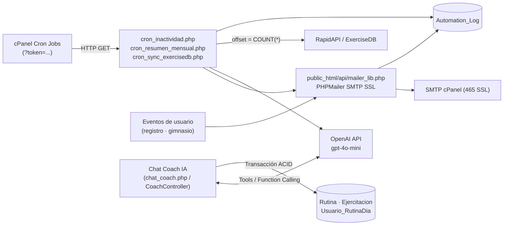

# Automatizaciones y Correos

GymTrack combina **correos transaccionales en tiempo real**, un **Coach Virtual con IA agéntica** y **procesos programados (Cron Jobs)** sobre cPanel sin depender de Composer ni carpetas `vendor/`.

## Infraestructura compartida

- **Configuración fuera de Git:** las credenciales SMTP y el token de crons viven en `public_html/api/mail_config.php` (a partir de `mail_config.example.php`); las claves de OpenAI y RapidAPI en `public_html/api/config.php` (a partir de `config.example.php`).
- **PHPMailer liviano:** se incluyen únicamente los 3 archivos del núcleo (`PHPMailer.php`, `SMTP.php`, `Exception.php`) en `public_html/api/PHPMailer/`.
- **Librería central (`public_html/api/mailer_lib.php`):** centraliza las plantillas HTML en Dark Mode, envío SMTP, gestión de tokens de verificación y avisos de gimnasio. Bloquea el acceso directo por web con `403`.
- **Seguridad en crons:** todos los endpoints `cron_*.php` exigen `?token=` coincidente con `CRON_TOKEN`; si falta o no coincide, responden `HTTP 403`.
- **Auditoría (`Automation_Log`):** cada corrida o envío transaccional registra `tipo`, `procesados`, `enviados`, `errores` y `detalle`.

## Correos transaccionales (tiempo real)

| Evento | Archivos | Comportamiento |
| --- | --- | --- |
| **Verificación al registrarse** | `register.php`, `AuthController.php`, `verificar_email.php`, `reenviar_verificacion.php` | Marca `Usuario.email_verificado = 'N'`, guarda el hash SHA-256 de un token aleatorio (válido 24 h) en `Verificacion_Email` y envía el enlace a `login.html?verificar_token=...`. El login exige la verificación (`403 EMAIL_NO_VERIFICADO`). Los usuarios previos y de demo quedan en `'S'`. |
| **Avisos por cambio de gimnasio** | `mailer_lib.php`, `gimnasio_lib.php`, `asignar_gimnasio.php`, `GimnasioController.php` | Envía correo tras confirmar la transacción (`commit`) cuando un socio es aceptado por solicitud, vinculado/desvinculado por un administrador o sale voluntariamente. Omite cuentas demo (`@example.com`) y nunca revierte el cambio si falla el SMTP. |

## Coach Virtual IA con Function Calling

- **Endpoints:** `public_html/api/chat_coach.php` y `backend/app/Http/Controllers/CoachController.php` (`POST /api/coach/chat`).
- **Modelo y herramienta:** utiliza OpenAI `gpt-4o-mini` con la definición de herramienta `guardar_rutina_usuario(nombre, ejercicios_ids)`.
- **Persistencia ACID:** cuando el usuario pide crear y guardar una rutina, el backend valida los IDs contra el catálogo real y ejecuta una transacción PDO atómica sobre `Rutina`, `Ejercitacion` y `Usuario_RutinaDia`.

## Procesos programados (Cron Jobs en cPanel)

| Script | Frecuencia | Qué hace |
| --- | --- | --- |
| `cron_inactividad.php` | Diario (`10:00`) | Detecta socios (`es_admin = 'N'`) con 5 o más días sin entrenar (`Historial`) y les envía un recordatorio HTML. Actualiza `Usuario.ultimo_recordatorio` para no repetir envíos antes de 5 días. |
| `cron_resumen_mensual.php` | Día 1 de cada mes (`09:00`) | Calcula días entrenados, series, volumen total (kg) y peso máximo del mes cerrado. Genera un párrafo motivacional personalizado con OpenAI (con *fallback* determinístico si hay error de red). |
| `cron_sync_exercisedb.php` | Bimestral, día 12 (`03:00`) | Consulta `COUNT(*)` local de `Ejercicio_ExerciseDB` y solicita a RapidAPI desde ese `offset` (*Zero-Waste*): si no hay ejercicios nuevos, consume una única petición HTTP. |

> Para configurar los Cron Jobs en cPanel y ver el formato de llamada por `curl`, consultar [docs/DESPLIEGUE.md](DESPLIEGUE.md).
