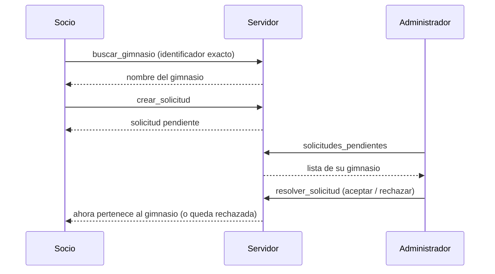

# Roles y gimnasios

## Quien es quien

| Rol | Como se reconoce | Que puede hacer |
| --- | --- | --- |
| **Socio** | `Usuario.es_admin = 'N'` | Entrenar, armar rutinas, ver su historial y su perfil. Puede pertenecer a **un** gimnasio o a ninguno |
| **Administrador** | `Usuario.es_admin = 'S'` | Ser duenio de **un** gimnasio, ver sus socios y estadisticas, aprobar o rechazar solicitudes |

- Un socio pertenece a un solo gimnasio a la vez: `Usuario.ID_Gimnasio` (nulo = sin gimnasio).
- Un administrador es duenio de un solo gimnasio: `Gimnasio.ID_Usuario_Dueno` es unico. Por ahora un gimnasio puede tener varias sedes sin que eso cambie el modelo.
- Un administrador **solo ve y modifica a los socios de su gimnasio**. Si todavia no creo el suyo, no ve datos de nadie.
- Los administradores no se unen a otros gimnasios como socios.

## Como se une un socio a un gimnasio

El socio busca el gimnasio por su **identificador exacto** (un texto publico, por ejemplo `fuerza-norte`) y manda una **solicitud**. El administrador la aprueba o la rechaza.

Estados de `Solicitud`: `pendiente`, `aceptada`, `rechazada`, `cancelada`.

### Reglas del alta

- **Una sola solicitud pendiente** por usuario.
- Quien ya tiene gimnasio **no puede pedir otro**: primero tiene que salir.
- Tras un **rechazo**, hay una espera de **7 dias** para volver a pedir a ese mismo gimnasio.
- No se puede listar ni buscar gimnasios por nombre parcial: hay que conocer el identificador. Las busquedas tienen un limite de intentos por minuto.
- El usuario **siempre sale de la sesion**: nadie puede pedir ni aprobar a nombre de otro.
- Las operaciones que modifican datos solo aceptan `POST`.

### Alta directa (extra)

El administrador tambien puede sumar a una persona **directamente**, buscandola por su mail exacto (`buscar_usuario` + `asignar_gimnasio`). Si esa persona tenia una solicitud pendiente, se cancela. Solo se puede sumar a quien no tiene gimnasio, y el administrador puede sacar de su gimnasio a cualquiera de sus socios.

## Donde viven las reglas

- `public_html/api/sesion.php`: quien llama (sesion) y permisos de administrador.
- `public_html/api/gimnasio_lib.php`: toda la logica de gimnasios y solicitudes, en un solo lugar. La usan los endpoints PHP y `backend/app/Http/Controllers/SolicitudController.php`.
- Las operaciones usan transacciones y bloquean primero al usuario y despues a la solicitud, para que dos pedidos simultaneos no dejen datos inconsistentes.
